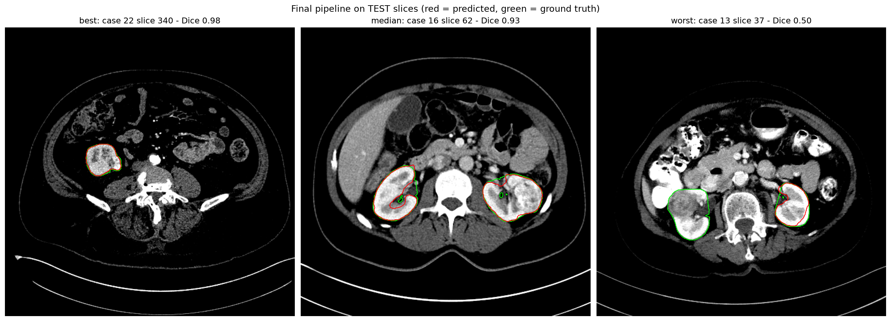
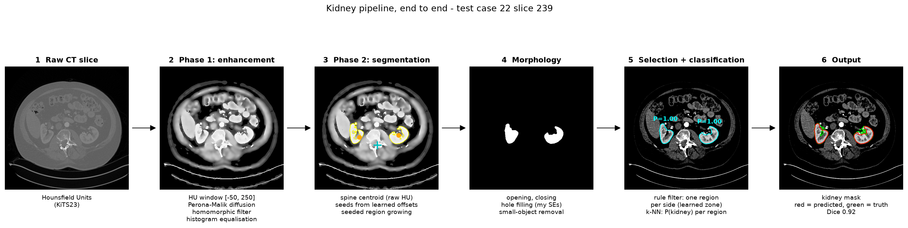
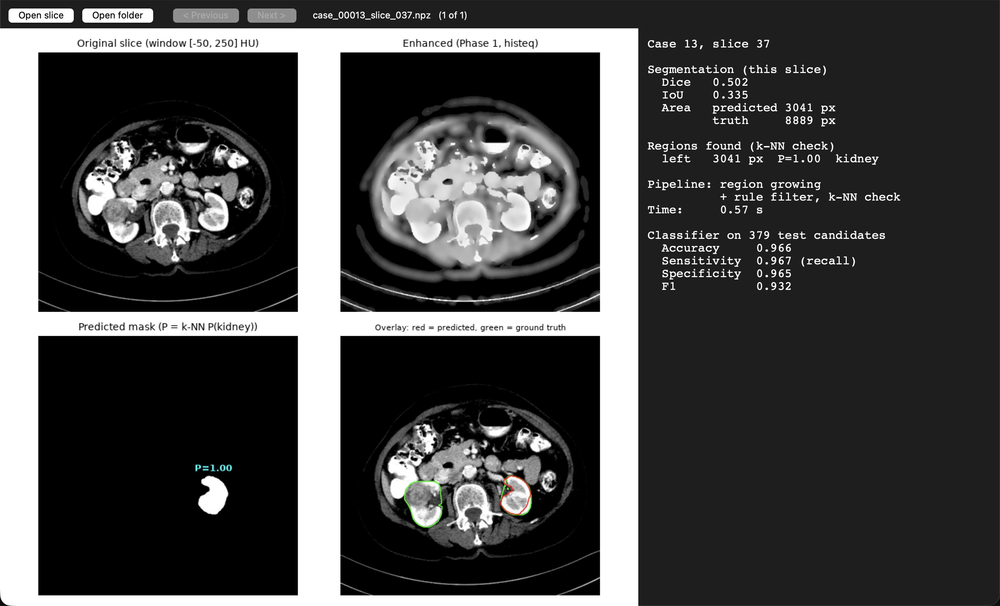

# Classical kidney segmentation in abdominal CT (KiTS23)

Segments both kidneys in abdominal CT slices with classical image processing — anisotropic
diffusion, seeded region growing and morphology — and checks every result with a k-NN classifier.
No deep learning. **Test Dice 0.889 (median 0.925)** on patients never used for any design decision.



Developed during my BSc in Computer Science as my component of a team medical-imaging project. This repository contains my kidney segmentation pipeline.

## The pipeline



1. **Raw CT slice** in Hounsfield Units (HU).
2. **Enhancement:** soft-tissue window → Perona–Malik anisotropic diffusion → homomorphic filter → histogram equalisation.
3. **Segmentation:** find the spine in raw HU, place one seed on each side at a learned offset, grow each kidney by seeded region growing.
4. **Morphology:** opening, closing, hole filling and small-object removal with hand-built structuring elements.
5. **Selection and check:** a rule learned from training data keeps one region per side; a k-NN classifier reports P(kidney) for each region.
6. **Output:** the kidney mask (about 0.5 s per slice).

## Results

8 training patients (48 slices) and 4 test patients (24 slices), split by patient. Every setting
was chosen on training patients only; test numbers are reported, never used to choose.

| | Training | Test |
|---|---|---|
| **Dice** (final pipeline) | 0.777 ± 0.250 (median 0.887) | **0.889 ± 0.106 (median 0.925)** |
| **IoU** (final pipeline) | 0.686 | **0.813** |
| Dice, comparison method (multi-Otsu) | 0.704 | 0.765 |
| **k-NN accuracy / sensitivity / specificity / F1** | 0.861 / 0.771 / 0.898 / 0.763 ¹ | **0.966 / 0.967 / 0.965 / 0.932** ² |
| **Runtime** | | about 0.45 s per slice (Apple-silicon Mac) |

¹ nested cross-validation (each patient classified by a model that never saw it). ² on all 379 candidate regions from the test slices.
Training is harder than test here because the training patients include the most difficult cases
(see [Limitations](#limitations-and-failure-cases)). All numbers: [`results/tables/final_results_summary.csv`](results/tables/final_results_summary.csv).

## Try it straight away

The 24 test slices, the trained models and all results are in the repository, so nothing has to be downloaded.

```bash
python3.14 -m venv .venv                       # Python 3.12, 3.13 or 3.14
.venv/bin/python -m pip install -r requirements.txt
.venv/bin/python demo_app.py sample_test_images
```
(Windows: `py -3.14 -m venv .venv`, then `.venv\Scripts\python ...`.)



The demo app shows the original slice, the enhanced slice, the predicted mask and the overlay,
with Dice, IoU, P(kidney) per region and the classifier's test metrics. **Open slice** / **Open folder**
load `.npz` slices; **Previous** / **Next** step through a folder. It needs Tkinter, which comes with
the python.org installers; Homebrew Python needs `brew install python-tk@3.14`, Ubuntu `sudo apt install python3-tk`.

Re-run the final test evaluation (works without the full dataset, in test-only mode):
```bash
.venv/bin/python scripts/step5_evaluate_test_set.py
```

### Use it from your own code

```python
import numpy as np
from src.pipeline import segment_kidney, segment_kidney_with_details

with np.load("sample_test_images/case_00013_slice_037.npz") as f:
    hu_slice = f["hu"].astype(np.float32)          # raw Hounsfield Units

mask = segment_kidney(hu_slice)                   # 2D bool array, True = kidney
details = segment_kidney_with_details(hu_slice)   # {"mask", "regions": [{"side", "area_px", "p_kidney", "mask"}]}
```
- Input: one axial slice in **raw HU**, standard radiology orientation (patient's front at the top,
  patient's right on the image's left). Run from the project folder, or add it to `sys.path`.
- Needs `models/segmentation_priors.json`, `models/feature_scaler.joblib` and `models/knn_classifier.joblib` (included).
- `.npz` slice files hold `hu` (int16 HU), `kidney_mask` (uint8, KiTS labels 1+2+3), `label_map`
  (KiTS labels 0–3), `pixel_spacing` (row_mm, col_mm), `case_id` and `slice_index`.

## Reproduce everything from raw data

```bash
.venv/bin/python scripts/run_all.py
```
This downloads KiTS23 cases 12–23 (about 0.9 GB: CT volumes from the
[KiTS23 Hugging Face mirror](https://huggingface.co/datasets/neheller/KiTS-Challenge-Imaging),
masks from the [official kits23 repository](https://github.com/neheller/kits23)) into `data/raw/`,
then runs all five steps in about 26 minutes. A clean re-run reproduces every table exactly;
the results are also identical on Python 3.12 and 3.14.

| Step | Script | What it does |
|---|---|---|
| 1 | `scripts/step1_prepare_data.py` | 6 axial slices per patient across each kidney (skipping the outer 10%), 8/4 split by patient |
| 2 | `scripts/step2_compare_enhancement.py` | compares windows, diffusion vs median, homomorphic settings, CLAHE vs histogram equalisation (PSNR, CNR) |
| 3 | `scripts/step3_compare_segmentation.py` | compares multi-Otsu and region growing (Dice, IoU); learns seed offsets and position/size zones |
| 4 | `scripts/step4_train_classifier.py` | 17 features, feature selection, k-NN tuned by patient-grouped (nested) cross-validation |
| 5 | `scripts/step5_evaluate_test_set.py` | final evaluation, failure analysis, test-image export |

Python 3.12, 3.13 or 3.14 on macOS, Windows or Linux. `requirements.txt` pins exact library versions so
every computer gets the same numbers (Python 3.11 is not supported: numpy 2.5 and scipy 1.18 need 3.12+).

## Project structure

```
config.py                  every setting, with what it does and why it was chosen
src/
  data_loading.py          download, orientation, slice selection, patient split
  phase1_enhancement.py    HU window, Perona-Malik diffusion, median, HE, CLAHE, DFT, homomorphic filter
  phase2_segmentation.py   body/bone/spine, structuring elements, morphology, multi-Otsu, region growing
  phase3_classification.py 17 features, feature selection, k-NN, nested cross-validation helpers
  metrics.py               PSNR, CNR, edge strength, Dice, IoU, confusion matrix, accuracy/recall/specificity/F1
  pipeline.py              segment_kidney() and segment_kidney_with_details()
scripts/                   steps 1-5 and run_all.py
demo_app.py                desktop demo (Tkinter)
models/                    learned seed offsets and zones; trained scaler and k-NN
results/                   every figure and table, and failure_analysis.md
sample_test_images/        the 24 test slices (.npz + PNG preview) - KiTS23 data, CC BY-NC-SA 4.0
```

## Methods

**Data.** KiTS23 cases 12–23. Ground truth = whole kidney (kidney + tumour + cyst labels), because
tumours and cysts lie inside the kidney outline. Every volume is turned to the standard radiology view.

**Phase 1 — enhancement.** A soft-tissue window [−50, 250] HU is mapped to 0–255. Noise is removed with
Perona–Malik anisotropic diffusion (Perona & Malik, 1990; written by hand in NumPy), compared against
median filtering. A homomorphic filter (log → FFT → Gaussian high-emphasis filter → inverse FFT → exp;
Oppenheim et al., 1968) follows, then global histogram equalisation, compared against CLAHE
(Zuiderveld, 1994). Settings were tuned on PSNR and on the contrast-to-noise ratio (CNR) between kidney
and a ring of surrounding tissue, with a rule that a smoothing filter must keep ≥ 90% of the kidney's edge strength.

**Phase 2 — segmentation.** Bone is found in raw HU (> 400 HU, with the spongy inside of each vertebra
filled) and excluded. Two strategies are compared:
- **A: multi-Otsu thresholding** (Otsu, 1979; Liao et al., 2001) into 3 classes, keeping the brightest.
- **B: seeded region growing** (Adams & Bischof, 1994; a hand-written queue-based, 8-connected version):
  one seed per side at the kidney's average offset from the spine centroid (learned from training data, scaled by
  body width). A seed must have a bright, cortex-like grey level, or the nearest such pixel is used; a pixel joins
  if it is within 20 grey levels of the region's running mean.

Both are cleaned with hand-built disk and kidney-shaped elliptical structuring elements (opening,
closing, hole filling, small-object removal). A rule learned from training data then keeps at most one
region per side of the spine, inside the usual kidney position and size. Region growing won (training
Dice 0.777 vs 0.704). Scored with Dice (Dice, 1945) and IoU (Jaccard, 1912).

**Phase 3 — classification.** Every candidate region (all multi-Otsu blobs and all region-growing
regions) is described by 17 features: 6 shape (area, perimeter/area, circularity, compactness,
eccentricity, solidity), 5 GLCM texture at 0°/45°/90°/135° counted only inside the region (energy, contrast,
homogeneity, correlation, entropy; Haralick et al., 1973), 4 first-order statistics of raw HU (mean,
variance, skewness, kurtosis) and 2 position features relative to the spine. Features are standardised
and classified with k-NN (Cover & Hart, 1967); compactness was dropped (it equals 4π/circularity) and
backward feature selection kept 7 features. k = 7 and the feature set were tuned with 5-fold cross-validation
grouped by patient (Kohavi, 1995), repeated inside each fold (nested) for honest estimates.

## Key findings

- **The right enhancement depends on what comes next.** Histogram equalisation had the *worst* CNR
  in Phase 1, yet it is by far the best input for region growing (training Dice 0.777, vs 0.632 with CLAHE):
  it pushes the kidney into the top grey levels, so it becomes one uniform region a seed can fill.
- **CNR is easy to fool.** It rewards clipping the background to black and blurring everything, so
  enhancement settings were chosen on the *median* CNR across slices with an edge-strength constraint.
- **The homomorphic filter's model does not fit CT.** It assumes uneven illumination, but CT values
  are calibrated HU; only a mild setting helped (+7% CNR) and the classic settings halved CNR.
- **Nested cross-validation changed the conclusion.** Selecting features on all training patients
  and then cross-validating gave F1 0.878 and suggested the k-NN should pick the kidney regions.
  Repeating the selection inside each fold gave the honest F1 0.763 (Ambroise & McLachlan, 2002),
  and with it the simple learned rule beat the k-NN (training Dice 0.777 vs 0.745).
- **So the k-NN verifies instead of deciding.** It runs on every returned region and reports P(kidney)
  without deleting anything. On the test set it flagged exactly one of 43 regions (P = 0.14),
  and that region was the only false one.

## Limitations and failure cases

6 of the 24 test slices score below Dice 0.85. Each is explained, with an example figure and a
realistic fix, in [`results/failure_analysis.md`](results/failure_analysis.md):

| Cause | Test slices | What goes wrong |
|---|---|---|
| boundary disagreement | 2 | the expert outline leaves the fat at the kidney's centre out; hole filling includes it |
| leak | 1 | the region escapes along vessels into the pancreas, so the rule filter rejects it |
| tumour not captured | 1 | growth stops where the tumour's density differs from the kidney's |
| seed outside the kidney | 1 | one average seed offset does not fit every slice level and patient |
| sliver kidney | 1 | a tiny kidney tip, where a few pixels dominate the Dice |

Wider limitations:
- **Small sample:** 12 patients and 6 slices each; 4 test patients cannot give tight error bars.
  The training set happens to contain the hardest patients, which is why test scores are higher.
- **2D only:** each slice is processed alone; neighbouring slices would help with kidney tips and seed placement.
- **Contrast-enhanced CT only,** in standard orientation. Other phases, scanners or orientations are untested.
- A research and learning project — **not for clinical use.**

## Dataset

Data from the **2023 Kidney and Kidney Tumor Segmentation Challenge (KiTS23)**,
https://kits-challenge.org/kits23/:

> Heller, N., Isensee, F., Trofimova, D., et al. (2023). The KiTS21 challenge: Automatic segmentation of
> kidneys, renal tumors, and renal cysts in corticomedullary-phase CT. arXiv:2307.01984.

The KiTS23 data is licensed under
[**CC BY-NC-SA 4.0**](https://creativecommons.org/licenses/by-nc-sa/4.0/) (attribution, non-commercial,
share-alike). The slices in `sample_test_images/` are extracted from it unchanged and stay under that licence.

## References

- Adams, R., & Bischof, L. (1994). Seeded region growing. *IEEE Transactions on Pattern Analysis and Machine Intelligence, 16*(6), 641–647.
- Ambroise, C., & McLachlan, G. J. (2002). Selection bias in gene extraction on the basis of microarray gene-expression data. *Proceedings of the National Academy of Sciences, 99*(10), 6562–6566.
- Bushberg, J. T., Seibert, J. A., Leidholdt, E. M., & Boone, J. M. (2012). *The essential physics of medical imaging* (3rd ed.). Lippincott Williams & Wilkins.
- Cover, T., & Hart, P. (1967). Nearest neighbor pattern classification. *IEEE Transactions on Information Theory, 13*(1), 21–27.
- Dice, L. R. (1945). Measures of the amount of ecologic association between species. *Ecology, 26*(3), 297–302.
- Gonzalez, R. C., & Woods, R. E. (2018). *Digital image processing* (4th ed., US edition). Pearson.
- Haralick, R. M., Shanmugam, K., & Dinstein, I. (1973). Textural features for image classification. *IEEE Transactions on Systems, Man, and Cybernetics, SMC-3*(6), 610–621.
- Huynh-Thu, Q., & Ghanbari, M. (2008). Scope of validity of PSNR in image/video quality assessment. *Electronics Letters, 44*(13), 800–801.
- Jaccard, P. (1912). The distribution of the flora in the alpine zone. *New Phytologist, 11*(2), 37–50.
- Kohavi, R. (1995). A study of cross-validation and bootstrap for accuracy estimation and model selection. *Proceedings of IJCAI*, 1137–1145.
- Liao, P.-S., Chen, T.-S., & Chung, P.-C. (2001). A fast algorithm for multilevel thresholding. *Journal of Information Science and Engineering, 17*(5), 713–727.
- Oppenheim, A. V., Schafer, R. W., & Stockham, T. G. (1968). Nonlinear filtering of multiplied and convolved signals. *Proceedings of the IEEE, 56*(8), 1264–1291.
- Otsu, N. (1979). A threshold selection method from gray-level histograms. *IEEE Transactions on Systems, Man, and Cybernetics, 9*(1), 62–66.
- Perona, P., & Malik, J. (1990). Scale-space and edge detection using anisotropic diffusion. *IEEE Transactions on Pattern Analysis and Machine Intelligence, 12*(7), 629–639.
- Zuiderveld, K. (1994). Contrast limited adaptive histogram equalization. In P. S. Heckbert (Ed.), *Graphics gems IV* (pp. 474–485). Academic Press.

## Licence

The code is released under the [MIT License](LICENSE). The KiTS23 data in `sample_test_images/` is
**not** covered by the MIT License; it remains under CC BY-NC-SA 4.0 (see [Dataset](#dataset)).
