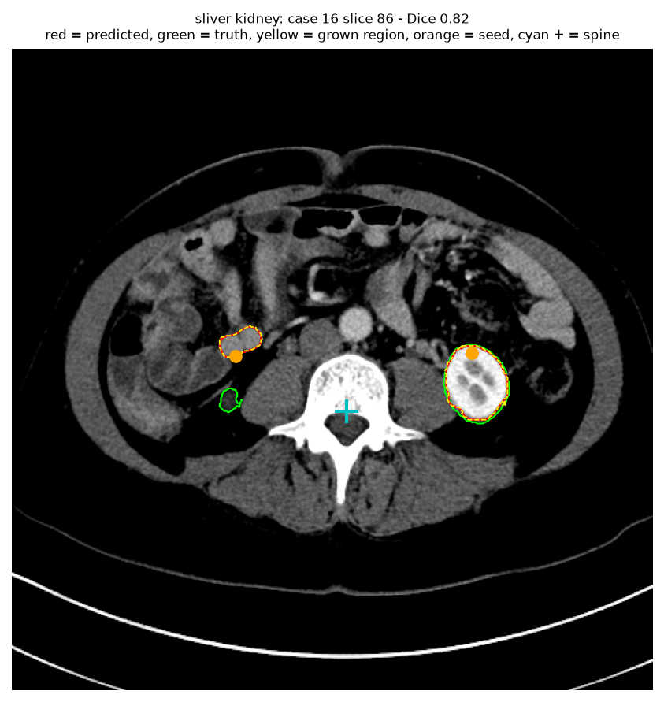
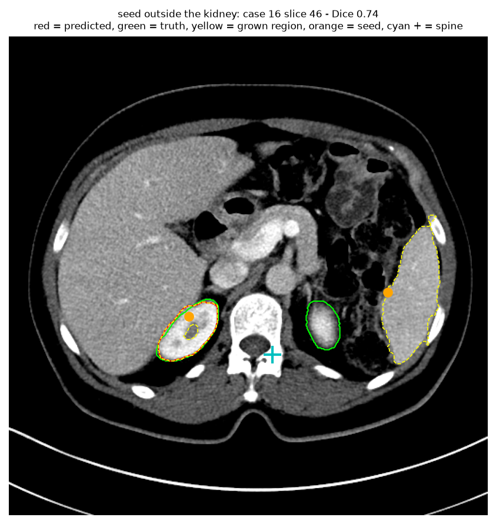
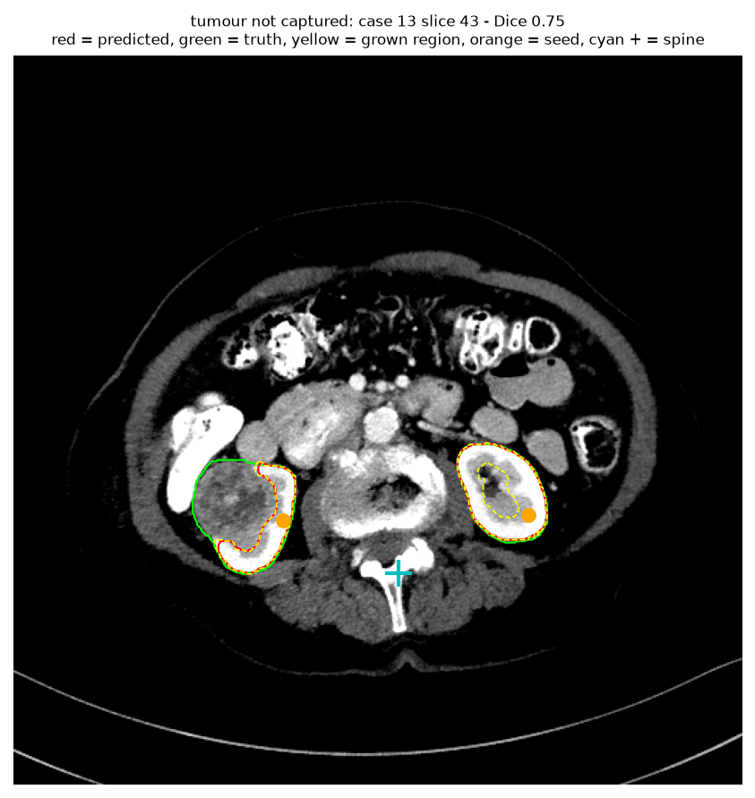
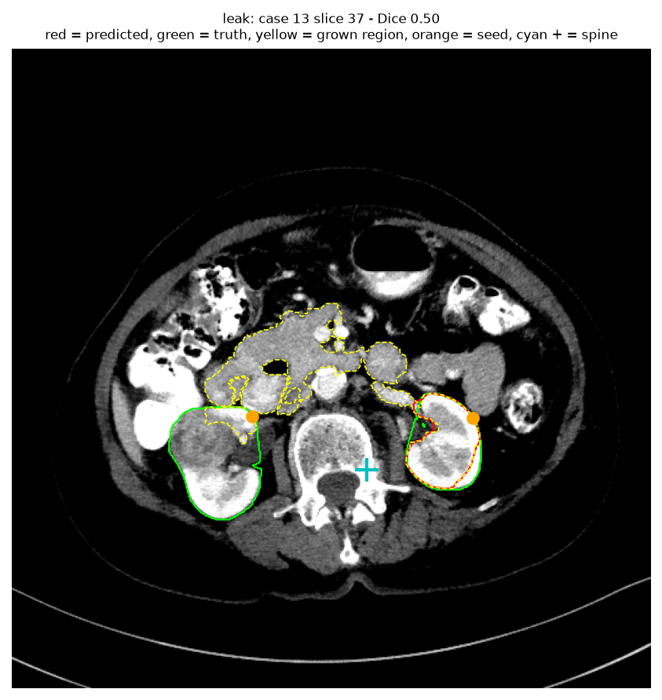
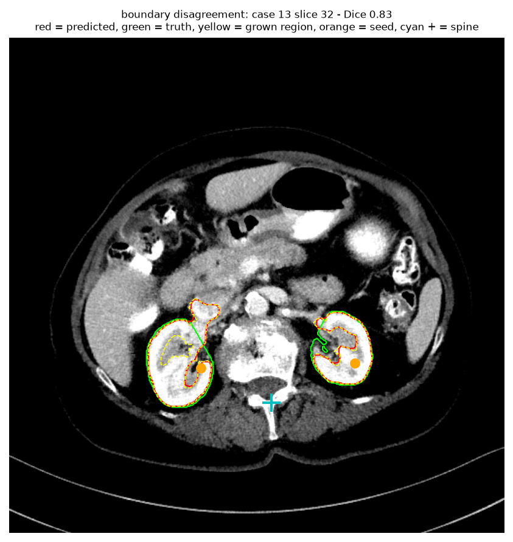

# Failure analysis - final pipeline on the test set

Final pipeline: region growing + rule filter, k-NN check (`USE_CLASSIFIER_IN_PIPELINE = False`).
6 of 24 test slices have Dice below 0.85 (test mean Dice 0.889, median 0.925). Each is assigned ONE primary cause by fixed rules (scripts/step5_evaluate_test_set.py, `failure_cause`), checked in the order below.

| Cause | Count | Slices (case/slice: Dice) |
|---|---|---|
| sliver kidney | 1 | 16/86: 0.82 |
| seed outside the kidney | 1 | 16/46: 0.74 |
| tumour not captured | 1 | 13/43: 0.75 |
| leak | 1 | 13/37: 0.50 |
| boundary disagreement | 2 | 13/32: 0.83, 20/31: 0.85 |

## Sliver kidney (1)

**What happens.** The ground-truth kidney on one side is only a thin tip (top or bottom pole, under 1000 pixels). It is either missed or a few pixels of boundary error dominate the Dice, because Dice is very sensitive on tiny objects.

Example: case 16 slice 86, Dice 0.82.

**Realistic fix (future work).** Use 3D context: segment the neighbouring slices first and carry the kidney position into the pole slices; report pole slices separately, or use a size-aware metric (e.g. boundary distance) for them.

## Seed outside the kidney (1)

**What happens.** The learned seed position (spine centroid + average offset) fell outside this kidney, so the region grew in another organ or nothing kidney-like was found nearby. Kidney position varies with slice level and between patients, but one average offset is used for every slice.

Example: case 16 slice 46, Dice 0.74.

**Realistic fix (future work).** Learn seed offsets as a function of slice level (upper pole / hilum / lower pole), or place several candidate seeds per side and let the k-NN pick the region that looks most like kidney.

## Tumour not captured (1)

**What happens.** Most of the missed kidney is tumour (KiTS label 2). The tumour's density differs from the enhancing cortex the seed sits on, so region growing stops at the tumour edge.

Example: case 13 slice 43, Dice 0.75.

**Realistic fix (future work).** Grow from a second seed inside the darker part enclosed by the kidney, or merge this mask with the output of a dedicated tumour segmentation so the whole-kidney outline includes the tumour.

## Leak (1)

**What happens.** The region grew beyond the kidney, usually along the renal vessels toward the spine or into touching bowel of similar brightness after equalisation. Either the leaked region is kept (precision below 75%), or it grew so large that the rule filter rejected it as not kidney-shaped and that side ends up empty (yellow = grown region in the figure). Kidneys with a large tumour are most at risk: their mixed density lets the running mean drift.

Example: case 13 slice 37, Dice 0.50.

**Realistic fix (future work).** Stop growth at strong edges (a gradient barrier) as well as on intensity, use a smaller tolerance once the region reaches the hilum, or open with a larger kidney-shaped structuring element.

## Boundary disagreement (2)

**What happens.** Both kidneys were found, but the outline differs from the expert's: the ground truth leaves the renal sinus fat out at the hilum while our hole filling includes it, and the blurred partial-volume edge is split differently.

Example: case 13 slice 32, Dice 0.83.

**Realistic fix (future work).** Do not fill the hilum notch (fill only fully enclosed holes away from the medial edge), and refine the final boundary on the un-equalised image.
